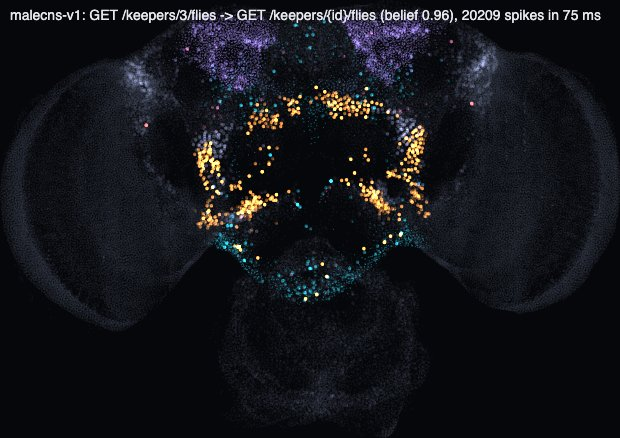

# FlyBoot

A Spring Boot-style web framework in which HTTP request routing is done by a simulated brain of the fruit fly *Drosophila melanogaster*, built from the real connectome: 138,639 neurons and 15 million connections.

```java
@FlyBootApplication
public class FlyClinicApplication {
    public static void main(String[] args) {
        FlyApplication.run(FlyClinicApplication.class, args);
    }
}

@FlyController
@FlyRequestMapping("/keepers")
public class KeeperController {
    @FlyGetMapping("/{id}")
    public Keeper get(@FlyPathVariable long id) { ... }
}
```

```
$ curl -i localhost:8080/keepers/1
HTTP/1.1 200 OK
X-Fly-Route: GET /keepers/{id}
X-Fly-Belief: 0.916
X-Fly-Spikes: 19312
X-Fly-Sniff-Ms: 75.0
{"id":1,"firstName":"Thomas","lastName":"Morgan","lab":"Fly Room, Columbia"}
```

## How it works

1. On startup the framework finds the controllers and their `@FlyGetMapping`, `@FlyPostMapping` and so on.
2. The fly "sniffs" synthetic requests to every endpoint and decoys that match none of them. A dopamine prediction error tunes the synapses from Kenyon cells and projection neurons onto route neurons. The result is cached in `.flyboot/`.
3. Every request becomes an odor: the method excites a pheromone glomerulus, path features excite ordinary glomeruli. Then 75 ms of brain activity are simulated with the Shiu et al. 2024 model, validated against the original Brian2 code.
4. The most confident route neuron wins. If it is the "unknown odor" neuron, the answer is 404. The dispatcher never matches path templates: it only carries out the fly's decision.

Accuracy on unseen path variable values is 96-100%, about 70-80% of requests to nonexistent addresses are rejected, routing a request takes 50-75 ms on CPU and 22-51 ms on GPU. With the brain's wiring shuffled (`--flyboot.brain.control=shuffled`) accuracy drops to 22%.



## Features

- **Two brains:** `--flyboot.brain.name=flywire-783` (female, brain, 139k neurons) or `malecns-v1` (male, brain and ventral nerve cord, 167k neurons).
- **Two engines:** a plain JVM on the CPU or TornadoVM on the GPU (`--flyboot.brain.engine=tornado`), a sniff is 4-5x faster.
- **Online learning:** `--flyboot.learning.online.enabled=true`. 2xx is a reward, 5xx and 405 are a punishment.
- **Brain in the browser:** `http://localhost:8080/actuator/brain/ui` shows how a request lights up the neurons and which route neuron wins.
- **Actuator:** `/actuator/health`, `/actuator/brain`, `/actuator/routes`.


## Quick start

You need JDK 25 (`.java-version` for jenv) and Maven. Download the data, install the framework into the local Maven repository and convert the brain:

```bash
./scripts/download-data.sh && mvn install && mvn -q -pl flyboot-connectome-tool exec:java
```

The male brain (about 560 MB):

```bash
./scripts/download-data.sh --malecns && mvn -q -pl flyboot-connectome-tool exec:exec@malecns
```

The GPU engine (Apple Silicon, Metal) needs TornadoVM:

```bash
sdk install tornadovm 7.0.1-jdk22plus-metal
```

## An application on FlyBoot

An application uses FlyBoot the way applications use Spring Boot. The parent `pom` sets versions, Java 25 and the `-parameters` flag that `@FlyPathVariable` names rely on; the dependency itself is the starter:

```xml
<parent>
    <groupId>dev.flyboot</groupId>
    <artifactId>flyboot-parent</artifactId>
    <version>0.1.0-SNAPSHOT</version>
    <relativePath/>
</parent>

<dependencies>
    <dependency>
        <groupId>dev.flyboot</groupId>
        <artifactId>flyboot-starter</artifactId>
    </dependency>
    <!-- optional: the GPU engine, works only under TornadoVM -->
    <dependency>
        <groupId>dev.flyboot</groupId>
        <artifactId>flyboot-tornado</artifactId>
        <scope>runtime</scope>
    </dependency>
</dependencies>
```


## Modules

| Module | What is inside |
|---|---|
| `flyboot-brain` | Connectome, LIF engine (a port of Shiu et al. 2024, validated against Brian2), population atlas, HTTP "nose", fly pool, route learning (`FlyRouter`) |
| `flyboot-core` | `@FlyComponent`, `@FlyBootApplication`, package scanning, constructor injection |
| `flyboot-web` | `@FlyController`, `@FlyGetMapping`..., `@FlyPathVariable`, `@FlyRequestParam`, `@FlyRequestBody`, `ResponseEntity`; HTTP server and a dispatcher where the fly picks the route |
| `flyboot-starter` | `FlyApplication.run`, `application.properties`, banner, `/actuator/*`, the `/actuator/brain/ui` page |
| `flyboot-tornado` | Optional GPU engine on TornadoVM; harmless on a plain JVM |
| `flyboot-connectome-tool` | Converts FlyWire v783 (DuckDB) and MaleCNS v1.0 (Apache Arrow) to `.flyb` |
| `flyboot-lab` | Experiments of phases 0-2 and a JMH benchmark |
| `tools/reference` | Reference run of the original model on Brian2 and the comparison |

## How the project was built

- Research and plan.
- Phase 0 - feasibility check: engine validated against Brian2 (r = 0.9997), odor discrimination, shuffled-wiring control.
- Phase 1 - brain module: the "nose", the fly pool, a 2x faster engine.
- Phase 2 - learning: why Kenyon cells, APL x3, prediction error and decoys for 404.
- Phase 3 - annotations, server, dispatcher.
- Phase 4 - starter, actuator, demo.
- Phase 5 - MaleCNS, online learning, GPU, visualization.

## Data and attribution

- FlyWire FAFB v783 connectome, license [CC BY-NC 4.0](https://flywire.ai/tos) (non-commercial use only):
  - Dorkenwald et al., Nature 2024;
  - Schlegel et al., Nature 2024;
  - neurotransmitter predictions: Eckstein et al., Cell 2024.
- MaleCNS v1.0 connectome (Janelia FlyEM, Cambridge, Google; Cell 2026), license [CC BY 4.0](https://male-cns.janelia.org/).
- Neuron model and prepared connectivity files: Shiu et al., "A Drosophila computational brain model reveals sensorimotor processing", Nature 2024, [philshiu/Drosophila_brain_model](https://github.com/philshiu/Drosophila_brain_model) (MIT). A copy of `model.py` is in `tools/reference/vendor`.
- The learning rule follows Bennett, Philippides, Nowotny (Nat Commun 2021): dopaminergic neurons compute a reward prediction error.
