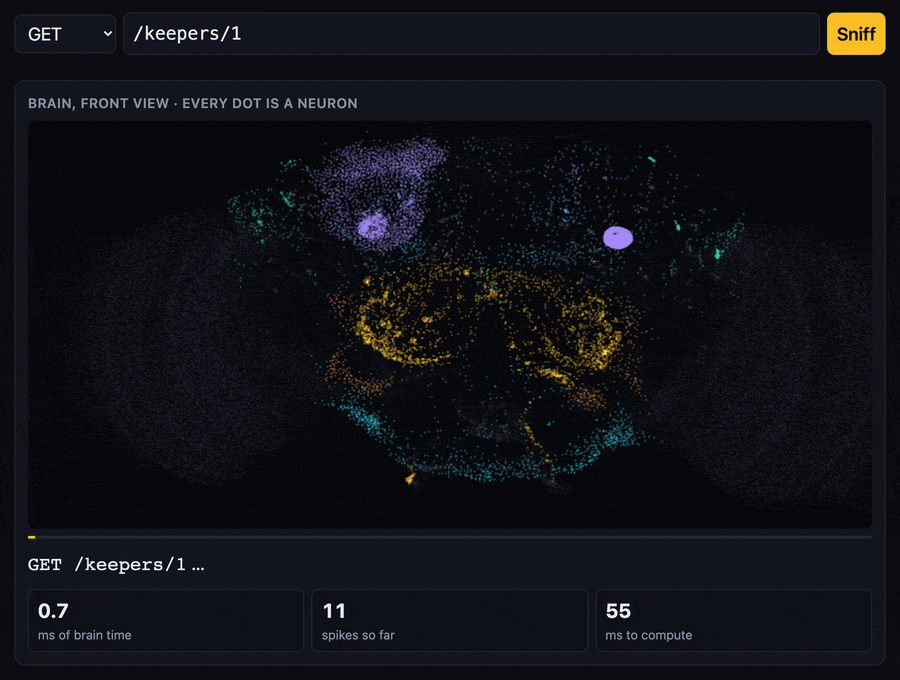

# FlyBoot



**A Spring Boot-style Java web framework whose HTTP router is a simulated fruit fly brain.** Request routing is done by a spiking simulation of the *Drosophila melanogaster* brain built from the real FlyWire connectome: 138,639 neurons and 15 million connections. No regex, no route table, no path template matching. The fly smells the request and decides which controller method answers it.

```java
@FlyBootApplication
public class FlyClinicApplication {
    public static void main(String[] args) {
        FlyApplication.run(FlyClinicApplication.class, args);
    }
}

@FlyController
@FlyRequestMapping("/keepers")
public class KeeperController {
    @FlyGetMapping("/{id}")
    public Keeper get(@FlyPathVariable long id) { ... }
}
```

```
$ curl -i localhost:8080/keepers/1
HTTP/1.1 200 OK
X-Fly-Route: GET /keepers/{id}
X-Fly-Belief: 0.916
X-Fly-Spikes: 19312
X-Fly-Sniff-Ms: 75.0
{"id":1,"firstName":"Thomas","lastName":"Morgan","lab":"Fly Room, Columbia"}
```

The request is turned into an odor, the fly sniffs it for 75 ms of brain time, and the most confident route neuron picks the handler. The fly gets it wrong about 3-5% of the time, and you can see that in the response headers.

To see FlyBoot in a real application, try [fly-boot-clinic](https://github.com/RustamKuramshin/fly-boot-clinic): a clinic for fruit flies with keepers, patients, entomologists and visits, 23 endpoints routed by the fly, a start script for a plain JVM and TornadoVM, and an end-to-end test on the real brain.


## Numbers

| | FlyWire (female) | MaleCNS (male) |
|---|---|---|
| Neurons and connections | 138,639 and 15.1 M | 166,700 and 25.6 M |
| Accuracy on unseen path variable values | 95-100% | 97-100% |
| Requests to nonexistent addresses rejected (404) | 70-77% | 72-83% |
| One 75 ms sniff on CPU, single thread | 82 ms | 127 ms |
| One 75 ms sniff on GPU (Apple M5 Max, Metal) | 22 ms | 25 ms |
| First training of 20-23 endpoints | 15-20 s | 16-30 s |

A restart with synapses from the cache takes about a second. Accuracy depends on the route set: 96.5-98.5% on 20 PetClinic-like endpoints, 94.8% on CPU and 97% on GPU for the 23 endpoints of [fly-boot-clinic](https://github.com/RustamKuramshin/fly-boot-clinic).

The number that matters most is the control. Shuffle the brain's wiring while keeping node degrees and synapse signs (`--flyboot.brain.control=shuffled`), and the same training procedure reaches only 22-24%. So the routing really comes from the fly's wiring, not from a trainable layer bolted onto a random network.

## How it works

### The nose: a request becomes an odor

`HttpNose` turns a request into firing rates of olfactory receptor neurons. The fly has 53 types of olfactory glomeruli, five of them pheromonal. The HTTP method excites its own pheromone glomerulus at 60 Hz:

| GET | POST | PUT | DELETE | PATCH |
|---|---|---|---|---|
| DA1 | VA1v | VA1d | DL3 | DC3 |

The path is split into features: the number of segments and, for each position, the segment literal and its shape (number, uuid, word, other). A stable hash maps every feature onto 2 of the 48 ordinary glomeruli, adding 30 Hz, capped at 60 Hz per glomerulus. The query string, the fragment and extra slashes do not change the odor.

The nose ignores the text of numbers and uuids and smells only their shape. Otherwise every new `{id}` value would be noise on two glomeruli, and Kenyon cells amplify that noise. The price: `/errors/404` and `/errors/500` smell the same to the fly.

### The brain: a whole-connectome simulation

The engine is a port of the leaky integrate-and-fire (LIF) model from Shiu et al. 2024 (Nature), the paper in which activating sugar-sensing gustatory neurons makes the simulated fly extend its proboscis. Model parameters: rest and reset −52 mV, threshold −45 mV, membrane time constant 20 ms, synaptic 5 ms, refractory period 2.2 ms, delay 1.8 ms, synaptic weight 0.275 mV, time step 0.1 ms. The model has no background noise: without input the brain is silent, and with a fixed seed the result is deterministic. The seed comes from a hash of the request, so the same request always goes to the same route.

The engine is validated against the original Brian2 `model.py`: 20 sugar receptors at 150 Hz, 30 runs of one second of brain time. Motor neuron MN9 fires at 79.6 Hz against 77.0 Hz in the reference, and firing rates across all neurons correlate at r = 0.9997.

Almost the whole brain stays silent during a sniff, so the engine is event-driven. Spikes propagate along CSR rows, and only neurons on the active list are updated. Each neuron's state is packed into a 16-byte record in an `int[]`, so a synaptic event touches one cache line instead of three.

### The mushroom body: what the fly learns

The whole brain is frozen except the synapses from Kenyon cells onto route neurons. In a real fly the synapses from Kenyon cells onto mushroom body output neurons (MBONs) are exactly the plastic ones, and dopamine tunes them.

On startup the framework finds every `@FlyGetMapping`, `@FlyPostMapping` and the rest and generates 60 requests per endpoint. Path variable values follow the parameter type: `long` and `int` teach numbers, `UUID` teaches uuids, `enum` teaches words, `String` teaches anything. Another 30 requests per route are decoys: mutations of real paths that match no template. A separate "unknown odor" neuron learns from them, and when it wins the answer is 404.

Route neurons read 520 most active Kenyon cells (binary) and 685 projection neurons (rates). Route neurons inhibit each other (softmax). The dopamine signal is reward minus expectation, a prediction error as in Bennett, Philippides, Nowotny (2021). Classes are balanced, weights do not decay. Trained synapses are cached in `.flyboot/flyroute-<fingerprint>.bin`. The fingerprint covers the brain, the model, nose and learning parameters, and the routes with their variable types, so changing any of them makes the fly learn again.

### The dispatcher: only the fly decides

`FlyDispatcher` hands the method and path to `RouteOracle`, which runs a sniff and returns a verdict: route, belief, spike count. If belief is below 0.3 or the unknown-odor neuron wins, the answer is 404. Otherwise the dispatcher carries out the fly's choice even when the path does not fit the template: variables are read by segment position of the chosen template.

After the fly decides, the dispatcher checks only protocol rules:
- the request method differs from the handler's method: 405 with an `Allow` header;
- the fly sent `/keepers/abc` to a handler with `long id`, and the variable cannot be converted: 400.

The verdict is always visible in `X-Fly-Route`, `X-Fly-Belief`, `X-Fly-Spikes`, `X-Fly-Sniff-Ms`, and when the fly picked a template the path does not literally match, in `X-Fly-Literal-Match: false` as well. `GET /cats/7`, for example, smells to the fly like "a resource with a number", and it confidently routes it to `GET /owners/{id}`.

## Features

Two brains. The default is `flywire-783`, the female brain from FlyWire FAFB v783. With `--flyboot.brain.name=malecns-v1` FlyBoot runs MaleCNS v1.0: brain and ventral nerve cord of a male fly, 166,700 neurons, 2.3 times as many synapses.

Two engines. A plain JVM on the CPU or TornadoVM on the GPU (`--flyboot.brain.engine=tornado`). The same jar runs both ways.

Online learning (`--flyboot.learning.online.enabled=true`). After every response the fly takes a step of the same prediction error rule: 2xx is a reward, 5xx and 405 are a punishment, other statuses teach nothing. If a handler keeps failing with 500, the fly gradually stops recognizing it and starts answering 404, the way a real fly learns to avoid an odor paired with an electric shock.

The brain in your browser: `http://localhost:8080/actuator/brain/ui`. Every dot is a real neuron at its anatomical position. A sniff replays in slow motion: receptors light up first, then projection neurons in the antennal lobes, Kenyon cells, the lateral horn, and finally the fly's decision. The request can be passed in the link: `…/actuator/brain/ui?method=GET&path=/cats/7`.

Spring-style components and web layer:
- `@FlyComponent` and meta-annotations, singletons with constructor injection, `@FlyAutowired`, clear errors for missing, ambiguous and circular dependencies;
- `@FlyController`, `@FlyRequestMapping`, `@FlyGetMapping`, `@FlyPostMapping`, `@FlyPutMapping`, `@FlyDeleteMapping`, `@FlyPatchMapping`, variables inside a segment (`/echo/{word}.{ext}`);
- arguments `@FlyPathVariable`, `@FlyRequestParam` (`required`, `defaultValue`, `List`), `@FlyRequestHeader`, `@FlyRequestBody` (JSON via Jackson 3), `HttpExchange`;
- return values: an object as JSON, `String`, `byte[]`, `ResponseEntity`, `@FlyResponseStatus`, `ResponseStatusException`;
- JSON errors with the fly's verdict: `{status, error, message, path, fly: {route, belief, spikes}}`;
- JDK `HttpServer`, one virtual thread per request.

On startup the registry rejects what the framework cannot serve: two handlers for one `METHOD /path`, a `@FlyPathVariable` missing from the template, two mapping annotations on one method.

## Quick start

You need JDK 25 (`.java-version` for jenv) and Maven. Download the data (about 104 MB, no registration), install the framework into the local Maven repository and convert the brain:

```bash
./scripts/download-data.sh && mvn install && mvn -q -pl flyboot-connectome-tool exec:java
```

The male brain (about 560 MB, conversion takes about 90 s):

```bash
./scripts/download-data.sh --malecns && mvn -q -pl flyboot-connectome-tool exec:exec@malecns
```

The GPU engine (Apple Silicon, Metal) needs TornadoVM. The application runs with plain `java` and TornadoVM's argument file: `java @$TORNADOVM_HOME/tornado-argfile ... --flyboot.brain.engine=tornado`.

```bash
sdk install tornadovm 7.0.1-jdk22plus-metal
```

## An application on FlyBoot

An application uses FlyBoot the way applications use Spring Boot. The parent `pom` sets versions, Java 25 and the `-parameters` flag that `@FlyPathVariable` names rely on; the dependency itself is the starter:

```xml
<parent>
    <groupId>dev.flyboot</groupId>
    <artifactId>flyboot-parent</artifactId>
    <version>0.1.0-SNAPSHOT</version>
    <relativePath/>
</parent>

<dependencies>
    <dependency>
        <groupId>dev.flyboot</groupId>
        <artifactId>flyboot-starter</artifactId>
    </dependency>
    <!-- optional: the GPU engine, works only under TornadoVM -->
    <dependency>
        <groupId>dev.flyboot</groupId>
        <artifactId>flyboot-tornado</artifactId>
        <scope>runtime</scope>
    </dependency>
</dependencies>
```

A complete example is [fly-boot-clinic](https://github.com/RustamKuramshin/fly-boot-clinic). Clone this repository into a `flyboot` directory next to it, because the clinic reads the converted brain from `../flyboot/data` by default.

## Properties

From lowest to highest precedence: `application.properties` on the classpath, environment variables (`SERVER_PORT` for `server.port`), `-Dkey=value`, `--key=value`.

| Property | Default | Meaning |
|---|---|---|
| `server.port`, `server.host` | `8080`, `0.0.0.0` | server address; port `0` picks a free one |
| `flyboot.brain.data-dir` | `data` | where converted brains live |
| `flyboot.brain.name` | `flywire-783` | `malecns-v1` or any `<name>.flyb` in the data directory |
| `flyboot.brain.engine` | `cpu` | `tornado` runs on the GPU |
| `flyboot.brain.w-syn` | from `<name>.brain.properties` | weight of one synapse, mV |
| `flyboot.brain.control` | `none` | `shuffled` rewires the brain randomly |
| `flyboot.brain.cache-dir` | `.flyboot` | synapse cache; `none` disables it |
| `flyboot.router.sniff-ms` | `75` | brain time per request |
| `flyboot.router.flies` | `0` | flies in the pool, `0` means one per processor; on GPU `-Dflyboot.tornado.flies=4` |
| `flyboot.router.min-belief` | `0.3` | belief below which the answer is 404 |
| `flyboot.router.apl-gain` | from the brain: `3` or `1.6` | gain of the inhibitory APL neuron |
| `flyboot.learning.samples-per-route`, `decoys-per-route`, `holdout-per-route` | `60`, `30`, `10` | training set size |
| `flyboot.learning.epochs`, `rate`, `seed` | `100`, `5`, `2026` | prediction error rule |
| `flyboot.learning.online.enabled`, `online.rate` | `false`, `0.5` | learning from response statuses |
| `flyboot.actuator.enabled`, `flyboot.banner.enabled` | `true`, `true` | actuator; banner (`banner.txt` on the classpath replaces the fly) |

The same fly routes the actuator, its addresses are among the learned endpoints:
- `/actuator/health` answers `{"status":"UP","fly":"buzzing"}`;
- `/actuator/brain?recent=10` shows the connectome, model parameters, training accuracy, cache, online learning and the fly's latest decisions;
- `/actuator/routes` lists endpoints with handlers and variable types;
- `/actuator/brain/ui`, `/actuator/brain/layout`, `/actuator/brain/sniff?method=GET&path=/keepers/1` are the visualization page and its data. A sniff through `sniff` does not teach the fly and does not call a handler.

## Modules

| Module | What is inside |
|---|---|
| `flyboot-brain` | Connectome, LIF engine, population atlas, the nose, fly pool, route learning (`FlyRouter`) |
| `flyboot-core` | `@FlyComponent`, `@FlyBootApplication`, package scanning (ClassGraph), constructor injection |
| `flyboot-web` | Controller annotations, HTTP server and the dispatcher where the fly picks the route |
| `flyboot-starter` | `FlyApplication.run`, properties, banner, `/actuator/*`, the `/actuator/brain/ui` page |
| `flyboot-tornado` | Optional GPU engine on TornadoVM; harmless on a plain JVM |
| `flyboot-connectome-tool` | Converts FlyWire v783 (DuckDB) and MaleCNS v1.0 (Apache Arrow) to `.flyb` |
| `flyboot-lab` | The experiments behind the design decisions and a JMH benchmark |
| `tools/reference` | Reference run of the Shiu et al. model on Brian2 and the comparison |

There are 66 tests. Tests on the real connectome are skipped when the data is missing.

## How the project was built

In autumn 2026 videos of a "fly brain" playing games and driving a virtual body spread across YouTube and social media. Patrick Mineault's breakdown of those demos showed that most of them press buttons almost at random, and that once you bolt a trainable layer onto the output, the connectome becomes a reservoir and it is no longer clear what the wiring contributes. That is why FlyBoot had a shuffled-wiring control brain from day one, and every experiment was compared against it.

The stack choice was between a Java engine, a Python brain on Brian2 behind gRPC, GraalPy, and the GPU. A custom LIF engine on Java 25 won: one process, the brain is visible in the debugger and the profiler, and the Shiu model is about 300 lines of code. Python stayed only for validation against the reference. FlyWire is read with DuckDB JDBC straight from parquet and csv.gz, without Python or Hadoop dependencies. The graph is stored in a custom binary CSR format (92 MB) that loads into the JVM in 30-200 ms.

The work went in five phases, and in each one the plan's hypothesis disagreed with the measurement.

**Phase 0, feasibility.** The first engine made MN9 fire at 97 Hz instead of 77. It turned out that Brian2 writes variables flagged `unless refractory` conditionally: input that reaches a neuron between its spike and the end of the refractory period is dropped. The paper does not mention it, yet it is what defines the model's behavior. After the fix the match reached r = 0.9997. An experiment with 10 synthetic odors gave 100% discrimination on Kenyon cells and 34% on the shuffled brain: there the receptor signal barely reaches the mushroom body, one sniff yields 1-2 Kenyon cell spikes. The nose prototype told 12 HTTP routes apart with 94.2% accuracy at a 75 ms sniff. The same phase showed that the Kenyon cell code was far too dense: 55-64% of the cells fired, against 5-10% in a real fly.

**Phase 1, the brain module.** A sniff cost 153 ms on one thread: about 7 million synaptic events, roughly 20 ns per event because of random memory access. Moving from separate `double` arrays to a packed 16-byte record with `float` brought it to 83 ms. To keep `float` from losing increments around 0.001 mV, the potential is stored as the offset from rest, `u = v - v0`. When 18 flies sniff at once each sniff slows to 197 ms: everything hits memory bandwidth.

**Phase 2, learning.** On 20 routes a nearest-centroid classifier on Kenyon cells gave 73-89%, and neither more samples nor a longer sniff helped. Reference classifiers showed where the information was lost: the odor itself is 100% separable, projection neurons 97.5%, Kenyon cells 78-89%. The Kenyon cell layer was to blame: in the LIF model the inhibitory APL neuron is spiking and weak, while in the fly it is graded. APL gain x3 brought the share of active cells down to 9.3%, as in a real fly. This is a deliberate departure from the reference. A Hebbian rule with error correction ruined the dense codes: punishment zeroed shared synapses, and projection neuron accuracy fell to 72-83%. A 404 neuron without class balancing stole real requests, and accuracy dropped to 79%. What worked was a prediction error rule with softmax and balanced classes: 96.5% on Kenyon cells together with projection neurons. In the fly the outputs of the mushroom body and of the lateral horn, which receives projection neuron axons, converge on shared downstream neurons, and route neurons play that role.

**Phase 3, annotations and the dispatcher.** The key decision: the dispatcher does not match templates, not even as a check. 405 and 400 stayed with the framework, because the request method and the variable type are protocol rules the fly does not smell. Handlers are sorted by `METHOD /path`, otherwise the synapse cache would not survive a restart with a different class scanning order. Dispatcher tests replace the fly with an ordinary template matcher to test HTTP mechanics apart from the probabilistic fly. In the end-to-end test the real fly routed 20 of 20 requests correctly.

**Phase 4, the starter.** `FlyApplication.run`, properties, banner, actuator. A 20-endpoint demo started in 16 s the first time and in about 1 s with the cache. With shuffled wiring the same demo started in 3.6 s but knew its routes only 22% of the time: `/pets/3` went to `POST /owners/{id}/pets`.

**Phase 5, the second brain, online learning, GPU and visualization.** With the 0.275 mV synaptic weight from the Shiu model the male brain gets overexcited: 93% of Kenyon cells fire. Calibration with `BrainProfile` and `RouterDemo` settled on 0.175 mV and APL x1.6: 7.5% of Kenyon cells active, 97.5% accuracy. The converter writes these parameters next to the brain in `malecns-v1.brain.properties`. For MaleCNS the synapse sign comes from `consensus_nt`: ACh, DA, 5-HT and OA excite, GABA, Glu and histamine inhibit. Annotations are mapped onto the FlyWire vocabulary, so the atlas, the nose and the router work on both brains unchanged.

The GPU engine did not beat the CPU right away. The synaptic delay is 18 steps, so all input of an 18-step window is known from the spikes of the previous window. Each window takes two kernels: `neurons` runs every neuron through 18 steps in registers and leaves a spike bitmask, `deliver` spreads spikes along CSR rows with integer `atomicAdd`. The first version with four kernel launches per window took 107 ms per sniff, slower than the CPU. Two launches per window gave 93 ms. Splitting one CSR row across 32 threads (projection neurons have thousands of synapses) gave 22 ms. Now GPU time is dominated by a fixed cost of about 0.5 ms per window, because Metal in TornadoVM waits synchronously for every launch, so even a silent brain costs 23 ms. Metal has no FP64, so the kernels use only `float` and `int`. The GPU matches the CPU engine at r = 0.9995 on firing rates, though not bit for bit.

Smaller traps that cost time:
- the Netty allocator in Apache Arrow fails on JDK 25, `arrow-memory-unsafe` fixed it;
- DuckDB cannot read the compressed Feather files of MaleCNS, so that converter uses Arrow Java;
- the `tornado` launcher does not pass application arguments through, so the JVM starts with `java @tornado-argfile`;
- JUL loses records in a shutdown hook, so shutdown messages go to `System.out`.

## Limitations

- Accuracy is about 95-98%, not 100%. From 17 to 30% of requests to nonexistent addresses go to a handler that smells similar. That is the fly's character rather than a bug, but do not put this router into production.
- Routing a request costs 50-75 ms on CPU and 22-51 ms on GPU. Throughput on a developer machine is about 110 requests per second.
- The model departs from the Shiu reference in two places: the APL gain, and route neurons that read projection neurons, not only Kenyon cells. Both departures are measured and described above.
- Online learning lives in memory. The synapse cache keeps the result of the initial training.
- FlyWire data is licensed under CC BY-NC 4.0, commercial use is not allowed. MaleCNS is CC BY 4.0.

## Data and attribution

- FlyWire FAFB v783 connectome, license [CC BY-NC 4.0](https://flywire.ai/tos) (non-commercial use only):
  - Dorkenwald et al., Nature 2024;
  - Schlegel et al., Nature 2024;
  - neurotransmitter predictions: Eckstein et al., Cell 2024.
- MaleCNS v1.0 connectome (Janelia FlyEM, Cambridge, Google; Cell 2026), license [CC BY 4.0](https://male-cns.janelia.org/).
- Neuron model and prepared connectivity files: Shiu et al., "A Drosophila computational brain model reveals sensorimotor processing", Nature 2024, [philshiu/Drosophila_brain_model](https://github.com/philshiu/Drosophila_brain_model) (MIT). A copy of `model.py` is in `tools/reference/vendor`.
- The learning rule follows Bennett, Philippides, Nowotny (Nat Commun 2021): dopaminergic neurons compute a reward prediction error.
